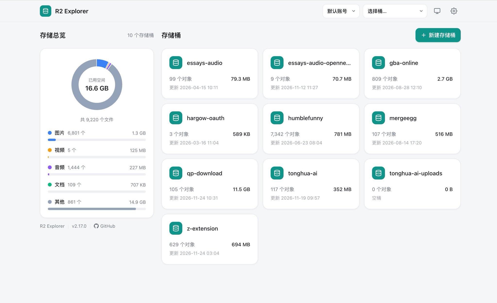
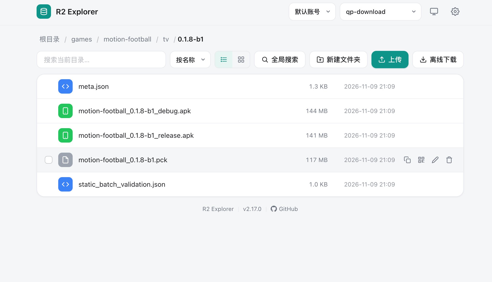
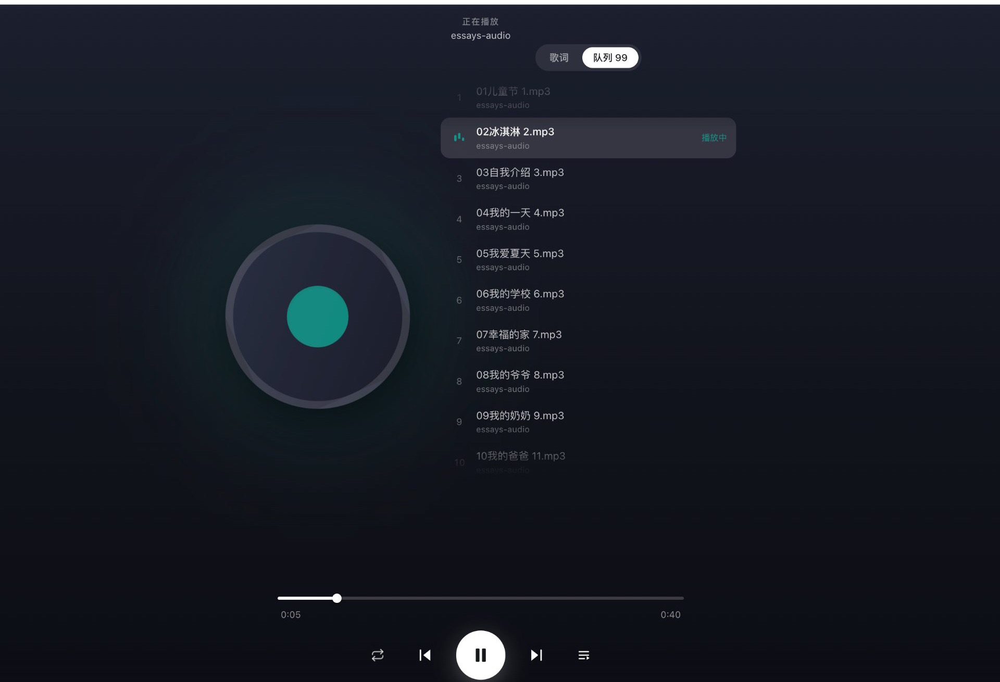
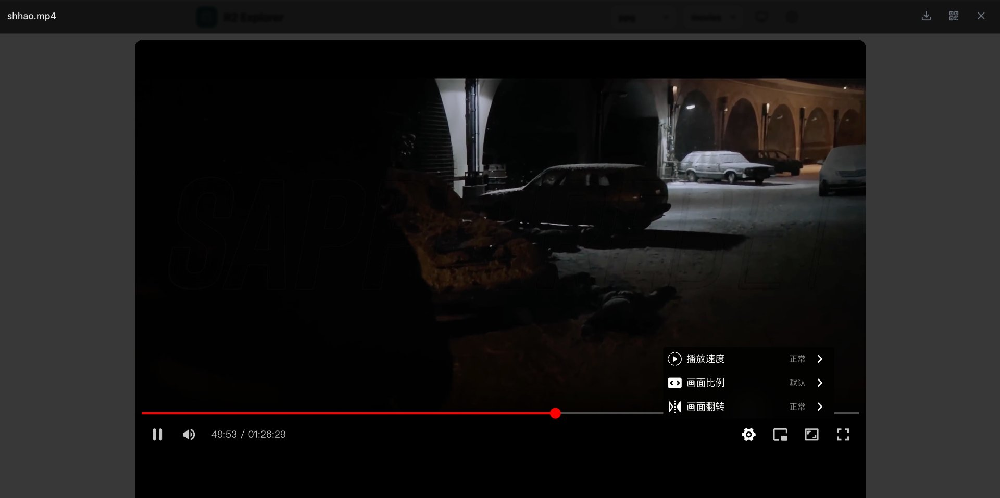
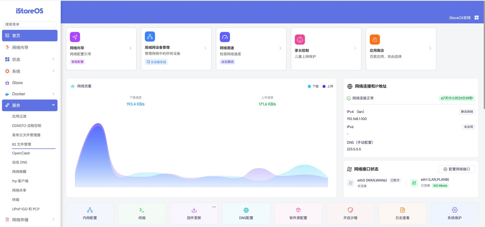
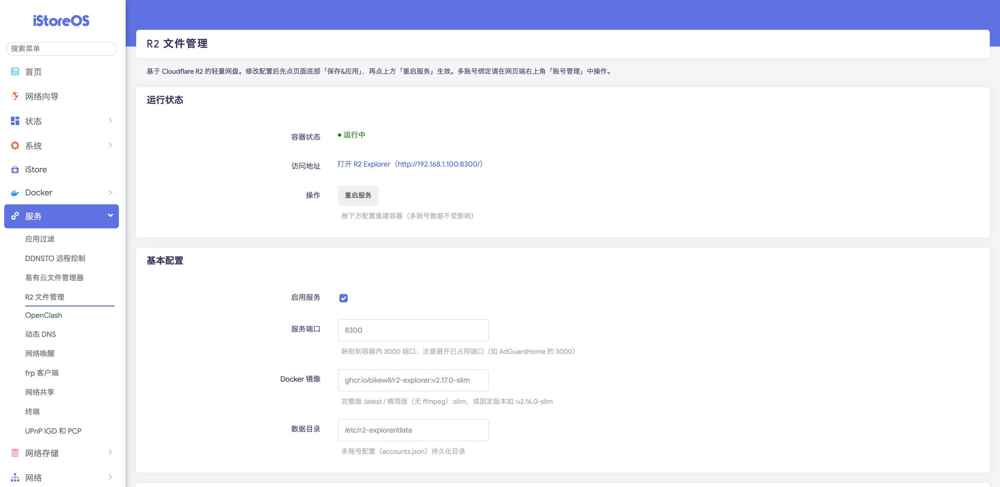

# R2 Explorer

**English** | [简体中文](README.md)


A lightweight file manager for Cloudflare R2: bind **multiple Cloudflare accounts** and switch between them on the fly, browse **every R2 bucket** under each account, inspect file sizes and timestamps, and copy CDN direct links with a single click.

- **Backend:** Node.js + [Hono](https://hono.dev) — the API is identical across Cloudflare Workers and Docker deployments
- **Frontend:** [Vite](https://vite.dev) + [React](https://react.dev) + [Tailwind CSS v4](https://tailwindcss.com) + zustand, hash-based routing (`#/bucket/path/`), responsive on both mobile and desktop
- **Authentication:** password login with an HMAC-signed HttpOnly cookie, valid for 30 days
- **Multi-account:** bind, edit, and unbind multiple R2 accounts from the UI, switch accounts from the top bar in one click, with credentials verified before saving
- **Bucket creation:** create new buckets in one click from the home (bucket overview) page — no trip to the Cloudflare console required
- **Upload:** direct upload up to 50MB; larger files automatically switch to multipart upload (16MB parts). Failed parts are retried automatically up to 3 times on network hiccups, and failed uploads offer a one-click "Retry". Large files resume from the last uploaded part (completed parts are never re-sent). Resume state lives only in the current page session — after a refresh you must re-select the file and start over
- **Bucket deletion:** delete empty buckets directly from the bucket card (requires typing the full bucket name as a second confirmation to prevent accidents)
- **Direct-link policy:** buckets with a custom domain configured in the account's `CDN mapping` use CDN links; unmapped buckets automatically get a **7-day presigned direct link**
- **QR codes:** generate a QR code in one click from the file row, context menu, grid card, or preview top bar — scan it on your phone to open or download the direct link, or save the QR image
- **Deployment:** Cloudflare Workers (recommended, static asset hosting) or self-hosted Docker

## Screenshots

| Bucket Overview | File Browser |
| :---: | :---: |
|  |  |

Online playback for common audio and video formats (the full image includes ffmpeg for in-browser transcoding of mkv/avi):

| Audio Player (lyrics, playback queue) | Video Player (speed, aspect ratio, flip) |
| :---: | :---: |
|  |  |

Running on an iStoreOS / OpenWrt router, with an integrated "R2 File Manager" LuCI plugin installed in one command:

| iStoreOS Home | LuCI "R2 File Manager" Plugin |
| :---: | :---: |
|  |  |

## Multi-Account Management

After signing in, click the **gear icon** in the top bar to open "R2 Account Management":

- **Bind:** provide a display name, Account ID, and Access Key ID / Secret Access Key (created under "R2 → Manage R2 API Tokens" in the Cloudflare console). Credentials are verified with a real ListBuckets call before saving
- **Switch:** change the active account from the dropdown in the top bar, or click "Use" inside the management dialog
- **Edit:** change the display name, CDN mapping, or keys (leave key fields empty to keep them unchanged)
- **Unbind:** removes only the association between this tool and the account — buckets and files are untouched

Where account configuration is stored:

| Deployment | Storage | Notes |
| --- | --- | --- |
| Cloudflare Workers | KV namespace `ACCOUNTS_KV` | Uncomment the KV block in `wrangler.toml` and fill in the id: `wrangler kv namespace create ACCOUNTS_KV` |
| Docker / Node | `data/accounts.json` | For Docker, mount a volume for persistence: `-v ./data:/app/data` |

When multi-account storage is not configured, the tool falls back to single-account mode using the `R2_ACCOUNT_ID` + `R2_ACCESS_KEY_ID` / `R2_SECRET_ACCESS_KEY` environment variables (shown in the UI as the built-in account, not editable or removable). If you manually bind an account with the same Account ID as the built-in one, the built-in entry is hidden automatically.

## Deploying to Cloudflare Workers (Recommended)

The frontend (`web/`) build output lands in `web/dist` and is served via **Workers Static Assets** (the `[assets]` block in `wrangler.toml`); the Worker only handles `/api/*`. **If you use a custom `wrangler.prod.toml`, it must contain the same `[assets]` block:**

```toml
[assets]
directory = "./web/dist"
not_found_handling = "single-page-application"
```

```bash
npm run build:web       # build the frontend first (CI does this too)
wrangler deploy
wrangler secret put AUTH_PASSWORD          # login password
wrangler secret put R2_ACCESS_KEY_ID       # R2 API Token credentials
wrangler secret put R2_SECRET_ACCESS_KEY
```

Vars in `wrangler.toml`: `R2_ACCOUNT_ID` and `R2_CDN_MAP` (JSON mapping bucket name → CDN domain). These act as the built-in default account; after signing in you can bind more accounts in the UI (stored in KV — see "Multi-Account Management").

> The Workers free plan has hard limits on CPU time, **subrequests (50 per request)**, and daily KV quota. For budgeting batch delete/move/offline-download operations, see the [Workers free-tier limits doc](docs/workers-free-tier-limits.md).

## CI/CD (GitHub Actions)

Pushing a `v*` tag automatically deploys the Worker (CI builds the frontend first), and a Telegram notification is sent whether the deploy succeeds or fails:

```bash
git tag v1.0.0 && git push origin v1.0.0
```

Two repository Actions secrets are required:

| Secret | Description |
| --- | --- |
| `CLOUDFLARE_ACCOUNT_ID` | Cloudflare Account ID (top of the right sidebar in the dashboard) |
| `CLOUDFLARE_API_TOKEN` | API Token created from the Cloudflare preset template "Edit Cloudflare Workers", including Workers Scripts:Edit and Workers Routes:Edit |

Optional configuration:

| Variable | Type | Description |
| --- | --- | --- |
| `TELEGRAM_WEBHOOK_URL` | secret | Sends deploy success/failure notifications to your webhook (request body: `{ fields: [{ label, value }] }` JSON) |
| `WRANGLER_CONFIG` | variable | Use a custom wrangler config file (e.g. `wrangler.prod.toml` with your real custom domains/KV ids); defaults to the in-repo `wrangler.toml` |
| `DEPLOY_URL` | variable | The live URL shown in the notification message |

## Local Development

Two processes — the Node backend and the Vite dev server, with `/api` already proxied:

```bash
cp .env.example .env   # fill in R2 credentials and AUTH_PASSWORD
npm install
npm run dev            # backend at http://localhost:3000
npm run dev:web        # frontend at http://localhost:5173 (use this while developing)
```

## Docker Deployment

```bash
docker build -t r2-explorer .    # multi-stage build: frontend first, then the runtime image

docker run -d --name r2-explorer -p 3000:3000 \
  -v ./data:/app/data \
  --env-file .env --restart unless-stopped r2-explorer
```

The `./data` volume persists the multi-account configuration bound in the UI (`data/accounts.json`).

## iStoreOS / Home-Router Deployment (Installer)

Don't want to type `docker run` by hand? Every `v*` tag automatically builds **amd64 + arm64 multi-arch images** and attaches two installers to the [Releases](https://github.com/oikewll/r2-explorer/releases) page:

| Package | Target Environment | Notes |
| --- | --- | --- |
| `r2-explorer-installer.run` | Any system with Docker (iStoreOS / OpenWrt / any Linux) | Self-extracting shell installer — one command to install and start |
| `r2-explorer_all.ipk` | iStoreOS / OpenWrt with iStore integrated | opkg package depending on `docker-deps` (iStore pulls it in automatically); upload via iStore's "Manual Install" |

Two image flavors: `latest` (full, includes ffmpeg for in-browser transcoding of mkv/avi, ~430MB) and `slim` (minimal, no ffmpeg, ~270MB, playback is left to the browser).

### Option 1: The .run Installer (Recommended)

```bash
# Run over SSH on your router (if pulling from ghcr is slow, configure a Docker registry mirror first)
wget -O /tmp/r2ex.run https://github.com/oikewll/r2-explorer/releases/latest/download/r2-explorer-installer.run
sh /tmp/r2ex.run                  # full flavor, default port 3000
sh /tmp/r2ex.run --slim           # slim flavor
sh /tmp/r2ex.run --port 8888      # custom port
```

The installer generates a random login password and prints the access URL. The password can be retrieved any time:

```bash
r2-explorer password              # show the login password
r2-explorer status                # container status
r2-explorer update                # upgrade the image (multi-account config survives)
r2-explorer uninstall --purge     # uninstall (--purge also removes local configuration)
```

### Option 2: Manually Install the .ipk via iStore (Recommended)

1. iStore → Manual Install → upload `r2-explorer_all.ipk`
2. In LuCI, go to the "Services" sidebar → **R2 File Manager**: configure the port, image flavor, login password, built-in R2 account environment variables, and custom environment variables; clicking "Restart Service" recreates the container with the new settings
3. Alternatively run `r2-explorer install` over SSH (the CLI and LuCI share the same UCI configuration)

### Option 3: Manual Build + LAN Offline Sync

For situations where the router can't pull from ghcr.io (DNS pollution, OpenClash not intercepting the router's own traffic, a purely offline network), or for trying your own changes before a release. The approach: **build the image on another machine and transfer it over the LAN with `docker save | docker load`** — no internet access on the router required.

Prerequisites: a Docker-capable machine (Mac / Linux / Windows) on the same LAN as the router, with SSH access.

```bash
# 1. Clone the repository and check out the target version
git clone https://github.com/oikewll/r2-explorer.git
cd r2-explorer
git checkout v2.17.0              # or track main for the latest code

# 2. Build the image locally
#    Use -f Dockerfile.slim for the slim flavor; use -f Dockerfile for the full flavor
#    Tag it with the version number so the router can tell images apart
docker build -f Dockerfile.slim -t ghcr.io/oikewll/r2-explorer:v2.17.0-slim .

# 3. (Optional) verify the build inside the image first
docker run --rm --entrypoint sh ghcr.io/oikewll/r2-explorer:v2.17.0-slim \
  -c "ls web/dist/assets | head"

# 4. Stream the image over SSH to the router and load it (LAN transfer, fast even for hundreds of MB)
docker save ghcr.io/oikewll/r2-explorer:v2.17.0-slim | ssh root@<router-ip> "docker load"

# 5. Point the service at this image on the router
#    .run installer route: edit IMAGE in /etc/r2-explorer/config.sh, then run r2-explorer restart
#    .ipk / LuCI route: set the image version on the "Services → R2 File Manager" page and click "Restart Service"
```

A few practical details:

- **Match the architecture:** home routers are almost always arm64 (aarch64) or x86_64 — check with `uname -m` first. Apple Silicon Macs are natively arm64, so a plain `docker build` works; on Intel Macs / x86 Linux, building for arm64 needs `--platform linux/arm64` (QEMU emulation, slower)
- **The image tag must exactly match the `IMAGE` setting:** the tag loaded via `docker load` must be identical to the configured `IMAGE`, otherwise `r2-explorer restart` will try to pull from the remote registry
- **The .run installer also works offline:** the `r2-explorer` CLI automatically falls back to a locally available image when `docker pull` fails, so "docker load first, then run the installer" also works
- **Same for upgrades:** repeat steps 2-5 for new versions; the multi-account configuration in `/etc/r2-explorer/data/` is unaffected

### Configuration Files

- `/etc/r2-explorer/config.sh`: port (`PORT`), image (`IMAGE`), data directory (`DATA_DIR`) — run `r2-explorer restart` after changes
- `/etc/r2-explorer/env`: login password (`AUTH_PASSWORD`) and optional built-in account environment variables (`R2_ACCOUNT_ID` / `R2_ACCESS_KEY_ID` / `R2_SECRET_ACCESS_KEY` — leave empty to bind accounts in the UI instead)
- `/etc/r2-explorer/data/`: persistent directory for the multi-account configuration (`accounts.json`); survives upgrades and container recreation

### Notes

- Images are hosted at `ghcr.io/oikewll/r2-explorer`; if ghcr is slow to reach, configure a Docker registry mirror in iStoreOS, or pass `--image <mirror-address/oikewll/r2-explorer:latest>` during installation
- The container runs with `--restart unless-stopped`, so it starts automatically with Docker when the router reboots
- Recommended for devices with ≥512MB RAM (the Node.js runtime uses roughly 100MB+). After installation, enable WebDAV (`/dav/`) to mount R2 as a local directory with rclone — see the WebDAV section below

## WebDAV (Docker/Node Version)

> See [docs/webdav-and-offline-download.md](docs/webdav-and-offline-download.md) for client configuration details and FAQs.

The self-hosted version ships with a WebDAV service mounted at `/dav/`: the root collection exposes all buckets of the currently active account, and `/dav/bucket/path` maps to files. Authentication is HTTP Basic: **any username, password = the login password** (`AUTH_PASSWORD`).

```bash
# Mount R2 as a local disk with rclone
rclone mount :webdav: --webdav-url=http://localhost:3000/dav/ --webdav-user=any \
  --webdav-pass=$(rclone obscure your-password) /mnt/r2

# Read and write directly with rclone
rclone ls :webdav, url=http://localhost:3000/dav/, user=any, pass=$(rclone obscure your-password):bucket-name

# macOS Finder: Go → Connect to Server → http://host:3000/dav/
# Windows Explorer: Map network drive → http://host:3000/dav/
```

Supports OPTIONS / PROPFIND / GET / HEAD / PUT (streaming uploads, large files never load into memory) / DELETE / MKCOL / COPY / MOVE / LOCK / UNLOCK. Note: directories are synthesized from R2 prefixes (empty directories fall back to a zero-byte marker); buckets themselves cannot be deleted via WebDAV; not available in the Workers version.

## Offline Download

The "Offline Download" button in the file list toolbar: paste an http/https direct link and the server streams the file in the background and stores it into R2 (no disk writes). After pasting, the filename and size are probed automatically (Content-Disposition takes priority) and can be edited; the task list shows progress and throughput in real time, and failed tasks can be retried.

- **Node/Docker version:** full-featured, multipart direct upload, ~80GB limit, concurrency 2; unfinished tasks are marked failed after a service restart and can be retried
- **Workers version:** restricted, single streaming upload, 100MB default limit (adjustable via `OFFLINE_MAX_SIZE_MB`), requires `ACCOUNTS_KV`, running tasks cannot be cancelled; subject to the free plan's daily KV quota (the task list uses a per-key index optimization so polling reads use get() and don't consume list() quota)

For details, Free/Paid plan comparison, and KV quota notes, see [docs/webdav-and-offline-download.md](docs/webdav-and-offline-download.md).

## Online Extraction (Node/Docker Version)

The "Extract" action in the file context menu (long-press on mobile): extracts an archive in full into a directory inside the bucket (default `current-dir/archive-name/`, configurable). Extraction runs as a server-side background task with the frontend polling for progress; failed entries are reported individually without breaking the whole run. Supports zip / rar / 7z / tar / tar.gz (zip-family containers such as apk, ipa, jar, xapk, and epub are also supported).

- Limits: single file ≤1GB, total extracted size ≤8GB, ≤5000 entries (zip has no whole-archive size limit; rar/7z/tar.gz are fully loaded into memory, ≤256MB); at most 2 concurrent extraction tasks
- Security: paths inside archives are sanitized (`..` traversal, absolute paths, and backslashes are all normalized or rejected) — nothing is written outside the target directory
- **Workers version:** zip-family only (zip/apk/ipa/jar/xapk/epub), single file ≤32MB, frontend-driven batch extraction (one batch per request, the page must stay open); rar/7z/tar.gz are Node/Docker only. Note: the free plan allows only 10ms CPU per request, so extracting anything but tiny files will fail — **the Workers version effectively requires the paid plan (30s CPU)**; on the free plan, download and extract locally instead

## API

| Method | Path | Description |
| --- | --- | --- |
| POST | `/api/login` | `{ password }`; sets the session cookie on success |
| POST | `/api/logout` | Clears the cookie |
| GET | `/api/me` | Session check |
| GET | `/api/accounts` | List accounts (secrets returned masked) |
| POST | `/api/accounts` | Bind a new account (credentials verified before saving) |
| PUT | `/api/accounts/:id` | Edit an account (name/CDN mapping/keys; empty keys are kept unchanged) |
| DELETE | `/api/accounts/:id` | Unbind an account |
| POST | `/api/accounts/:id/activate` | Make this account the active one |
| GET | `/api/buckets` | List all buckets under the active account |
| POST | `/api/buckets` | Create a bucket `{ name }` (under the active account; lowercase letters/digits/hyphens only) |
| DELETE | `/api/buckets/:name` | Delete a bucket (must be empty; the frontend requires typing the full bucket name to confirm) |
| GET | `/api/list?bucket=x&prefix=a/` | List a directory (folders + files + direct links) |
| GET | `/api/info?bucket=x&key=a/b` | Single-file details (size/time/ETag/type) |
| DELETE | `/api/object?bucket=x&key=a/b` | Delete a single file |
| POST | `/api/delete-batch` | `{ bucket, keys: [] }` batch delete (≤500) |
| POST | `/api/move` | `{ bucket, items: [{ from, to }] }` move/rename (≤100) |
| GET | `/api/text?bucket=x&key=a/b` | Text preview proxy (≤2MB) |
| GET | `/api/zip` / `/api/zip-entry` | Archive directory / entry reader |
| POST | `/api/upload` | Raw body direct upload, single file ≤100MB |
| POST | `/api/multipart/init` / `part` / `complete` / `abort` | Multipart upload (>50MB switches automatically; parts ≤64MB, unlimited count) |
