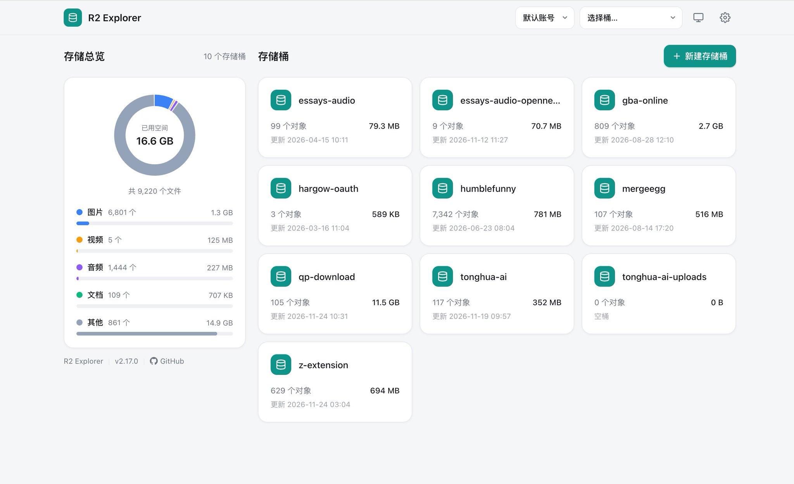
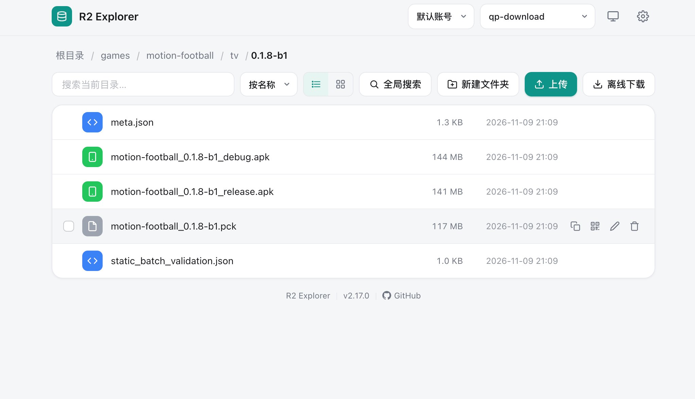
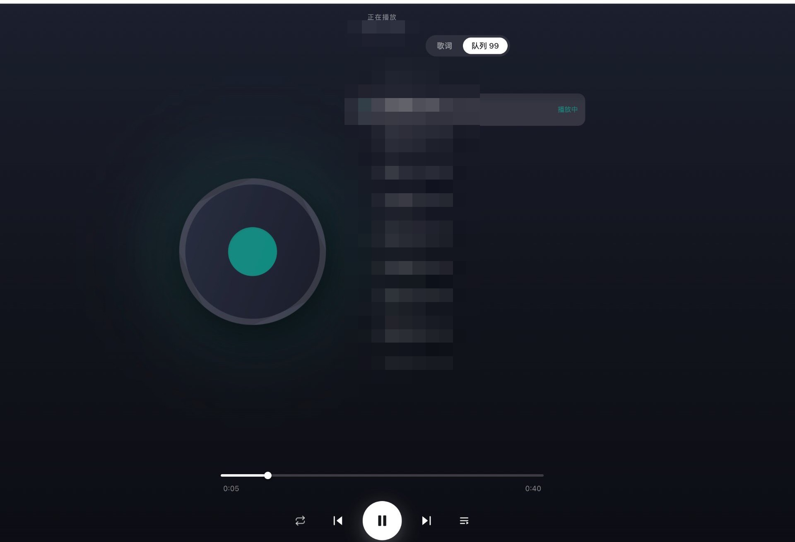
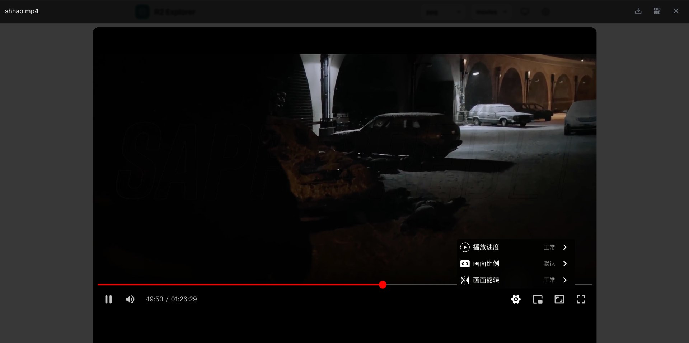
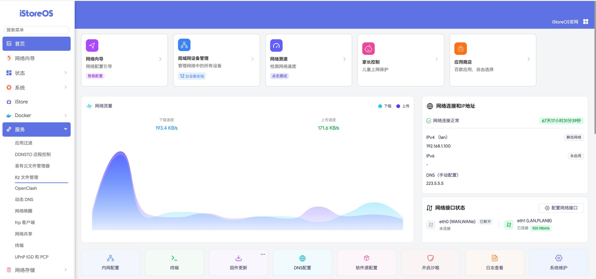
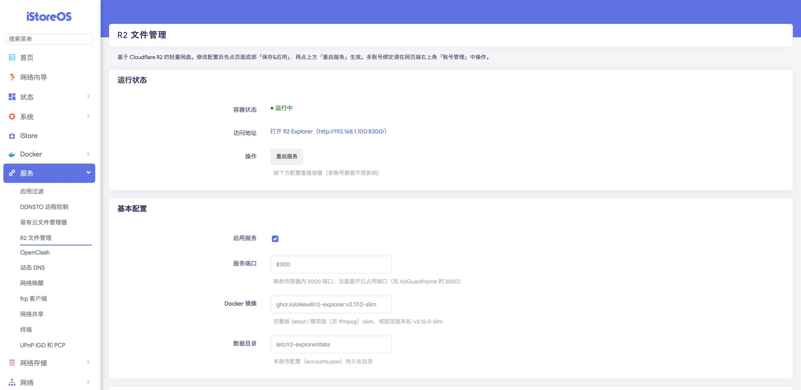

# R2 Explorer

**简体中文** | [English](README.en.md)


基于 Cloudflare R2 的轻量文件管理器：绑定**多个 Cloudflare 账号**并随时切换、浏览账号下**所有 R2 存储桶**、查看文件大小/时间、一键复制 CDN 直链。

- 后端：Node.js + [Hono](https://hono.dev)（API 不变，Workers 与 Docker 双部署）
- 前端：[Vite](https://vite.dev) + [React](https://react.dev) + [Tailwind CSS v4](https://tailwindcss.com) + zustand，hash 路由（`#/桶名/路径/`），适配手机与 PC
- 鉴权：密码登录，HMAC 签名 HttpOnly Cookie，30 天有效
- 多账号：界面里绑定/编辑/解绑多个 R2 账号，顶栏一键切换，绑定前自动验证凭证
- 新建桶：首页（桶总览）一键新建存储桶，无需去 Cloudflare 控制台
- 上传：≤50MB 直传、>50MB 自动分片（16MB/片）；网络抖动分片自动重试 3 次，失败可一键「重试」，大文件从已上传的分片续传（不重传已完成部分）。断点信息只保存在当前页面会话内，刷新页面后需重新选文件从头上传
- 删除桶：桶卡片上可删除空存储桶（需输入完整桶名二次确认），防止误删
- 直链策略：各账号的 `CDN 映射` 里配置了自定义域的桶用 CDN 链接；未配置的桶自动生成 **7 天预签名直链**
- 二维码：文件行右侧、右键菜单、网格卡片、预览顶栏一键生成二维码，手机扫码即可打开 / 下载直链，也可保存二维码图片
- MCP 服务：内置只读 MCP 端点（`/mcp`），外部 Agent（WorkBuddy / Claude / Cursor 等）配一个 URL + Token 即可查询 R2 存储
- 部署：Cloudflare Workers（推荐，静态资产托管）或 Docker 自托管

## 界面截图

| 存储桶总览 | 文件浏览 |
| :---: | :---: |
|  |  |

支持主流音频 / 视频在线播放（完整版镜像含 ffmpeg，可在线转码 mkv/avi）：

| 音频播放（歌词、播放队列） | 视频播放（倍速、画面比例、画面翻转） |
| :---: | :---: |
|  |  |

部署在 iStoreOS / 软路由上，LuCI 集成「R2 文件管理」插件，一条命令安装：

| iStoreOS 首页 | LuCI「R2 文件管理」插件 |
| :---: | :---: |
|  |  |

## 多账号管理

登录后点击顶栏 **齿轮图标** 进入「R2 账号管理」：

- **绑定**：填备注名称、Account ID、Access Key ID / Secret Access Key（Cloudflare 控制台「R2 → 管理 R2 API 令牌」创建），保存前会用凭证真实调一次 ListBuckets 验证
- **切换**：顶栏下拉框直接切换当前使用的账号，或 在管理弹窗里点「使用」
- **编辑**：改备注名、CDN 映射、换密钥（密钥留空表示不修改）
- **解绑**：只解除工具与账号的关联，存储桶和文件不受影响

账号配置存放在：

| 部署方式 | 存储 | 说明 |
| --- | --- | --- |
| Cloudflare Workers | KV namespace `ACCOUNTS_KV` | 需在 `wrangler.toml` 取消注释 KV 配置并填入 id：`wrangler kv namespace create ACCOUNTS_KV` |
| Docker / Node | `data/accounts.json` | Docker 部署建议挂载卷持久化：`-v ./data:/app/data` |

未配置多账号存储时，自动回退为单账号模式：使用 `R2_ACCOUNT_ID` + `R2_ACCESS_KEY_ID` / `R2_SECRET_ACCESS_KEY` 环境变量（界面里标记为「内置」账号，不可编辑删除）。若手动绑定了与内置相同 Account ID 的账号，内置项会自动隐藏去重。

## Cloudflare Workers 部署（推荐）

前端（`web/`）构建产物在 `web/dist`，通过 **Workers Static Assets** 托管（`wrangler.toml` 的 `[assets]` 配置），Worker 只处理 `/api/*`。**如果你使用自定义 `wrangler.prod.toml`，必须包含同样的 `[assets]` 段**：

```toml
[assets]
directory = "./web/dist"
not_found_handling = "single-page-application"
```

```bash
npm run build:web       # 先构建前端（CI 也会自动构建）
wrangler deploy
wrangler secret put AUTH_PASSWORD          # 登录密码
wrangler secret put R2_ACCESS_KEY_ID       # R2 API Token 的密钥
wrangler secret put R2_SECRET_ACCESS_KEY
```

`wrangler.toml` 里的 vars：`R2_ACCOUNT_ID`、`R2_CDN_MAP`（JSON，桶名 → CDN 域）。这两个作为「内置默认账号」，登录后可在界面里绑定更多账号（存 KV，见「多账号管理」）。

> 免费版有 CPU 时间、**子请求数（50 次/请求）**、KV 每日配额等硬限制，批量删除/移动/离线下载等功能的额度预算见 [Workers 免费版额度说明](docs/workers-free-tier-limits.md)。

## CI/CD（GitHub Actions）

打 `v*` tag 推送即自动部署 Worker（CI 会先构建前端再部署），成功/失败都会推 Telegram 通知：

```bash
git tag v1.0.0 && git push origin v1.0.0
```

需要两个仓库 Actions secrets：

| Secret | 说明 |
| --- | --- |
| `CLOUDFLARE_ACCOUNT_ID` | Cloudflare Account ID（仪表盘右侧栏可查） |
| `CLOUDFLARE_API_TOKEN` | API Token，用 Cloudflare 预设模板「编辑 Cloudflare Workers」，需包含 Workers Scripts:Edit、Workers Routes:Edit |

可选配置：

| 变量 | 类型 | 说明 |
| --- | --- | --- |
| `TELEGRAM_WEBHOOK_URL` | secret | 部署成功/失败推送通知到自己的 webhook（请求体为 `{ fields: [{ label, value }] }` JSON） |
| `WRANGLER_CONFIG` | variable | 指定自己的 wrangler 配置文件（如 `wrangler.prod.toml`，可放真实自定义域/KV id），默认用仓库内 `wrangler.toml` |
| `DEPLOY_URL` | variable | 通知消息里展示的线上地址 |

## 本地开发

后端（Node）与前端（Vite dev server）两个进程，前端已配置 `/api` 代理：

```bash
cp .env.example .env   # 填好 R2 凭证与 AUTH_PASSWORD
npm install
npm run dev            # 后端 http://localhost:3000
npm run dev:web        # 前端 http://localhost:5173（开发时访问这个）
```

## Docker 部署

```bash
docker build -t r2-explorer .    # 多段构建：先构建前端，再打运行镜像

docker run -d --name r2-explorer -p 3000:3000 \
  -v ./data:/app/data \
  --env-file .env --restart unless-stopped r2-explorer
```

挂载 `./data` 卷用于持久化界面里绑定的多账号配置（`data/accounts.json`）。

## iStoreOS / 软路由部署（安装器）

不想手动敲 `docker run`？每次打 `v*` tag 会自动构建 **amd64 + arm64 双架构镜像**，并在 [Releases](https://github.com/oikewll/r2-explorer/releases) 附带两种安装包：

| 安装包 | 适用环境 | 说明 |
| --- | --- | --- |
| `r2-explorer-installer.run` | 任何带 Docker 的系统（iStoreOS / OpenWrt / 任意 Linux） | 自解压 shell 安装器，一条命令装完并启动 |
| `r2-explorer_all.ipk` | iStoreOS / 集成了 iStore 的 OpenWrt | opkg 包，依赖 `docker-deps`（iStore 会自动带上 Docker），可在 iStore「手动安装」里上传 |

镜像版本两种：`latest`（完整版，含 ffmpeg，网页端可在线转码播放 mkv/avi，约 430MB）；`slim`（精简版，无 ffmpeg，约 270MB，播放交给浏览器解码）。

### 方式一：.run 安装器（推荐）

```bash
# SSH 进软路由后执行（国内网络拉 ghcr 慢的话先配 Docker 镜像加速）
wget -O /tmp/r2ex.run https://github.com/oikewll/r2-explorer/releases/latest/download/r2-explorer-installer.run
sh /tmp/r2ex.run                  # 完整版，默认端口 3000
sh /tmp/r2ex.run --slim           # 精简版
sh /tmp/r2ex.run --port 8888      # 自定义端口
```

安装器会自动生成随机登录密码并打印访问地址，密码也可随时查看：

```bash
r2-explorer password              # 查看登录密码
r2-explorer status                # 容器状态
r2-explorer update                # 升级镜像（多账号配置不丢）
r2-explorer uninstall --purge     # 卸载（--purge 连本地配置一起删）
```

### 方式二：iStore 手动安装 .ipk（推荐）

1. iStore → 手动安装 → 上传 `r2-explorer_all.ipk`
2. LuCI 左侧「服务」菜单 → **R2 文件管理**：可配置端口、镜像版本、登录密码、内置 R2 账号环境变量与自定义环境变量，点「重启服务」即按配置重建容器
3. 也可以 SSH 执行 `r2-explorer install` 启动（CLI 与 LuCI 共用 UCI 配置）

### 方式三：手动构建 + 局域网离线同步

适用场景：软路由拉不动 ghcr.io（DNS 污染、OpenClash 不接管路由器自身流量、纯内网环境），或想在发版前跑自己的改动。原理是**在另一台机器上构建镜像，通过局域网 `docker save | docker load` 直传**，完全不依赖软路由的外网。

前提：一台装了 Docker 的电脑（Mac / Linux / Windows 均可），与软路由在同一局域网且能 SSH。

```bash
# 1. 克隆仓库并检出目标版本
git clone https://github.com/oikewll/r2-explorer.git
cd r2-explorer
git checkout v2.17.0              # 或 main 跟踪最新代码

# 2. 本地构建镜像
#    精简版用 -f Dockerfile.slim；完整版用 -f Dockerfile
#    tag 建议带上版本号，方便软路由上区分
docker build -f Dockerfile.slim -t ghcr.io/oikewll/r2-explorer:v2.17.0-slim .

# 3. （可选）构建前先在镜像里验证功能
docker run --rm --entrypoint sh ghcr.io/oikewll/r2-explorer:v2.17.0-slim \
  -c "ls web/dist/assets | head"

# 4. 经 SSH 管道直传软路由并载入（走局域网，几百 MB 很快）
docker save ghcr.io/oikewll/r2-explorer:v2.17.0-slim | ssh root@<软路由IP> "docker load"

# 5. 软路由上让服务用上这个镜像
#    走 .run 安装器路线：改 /etc/r2-explorer/config.sh 里的 IMAGE 后执行 r2-explorer restart
#    走 .ipk / LuCI 路线：在「服务 → R2 文件管理」页把镜像版本改成该 tag，点「重启服务」
```

几个实用细节：

- **架构要匹配**：软路由基本都是 arm64（aarch64）或 x86_64，先 `uname -m` 确认。Apple Silicon Mac 原生就是 arm64，直接 `docker build` 即可；Intel Mac / x86 Linux 构建 arm64 需加 `--platform linux/arm64`（QEMU 模拟，较慢）
- **镜像 tag 与 `IMAGE` 配置严格一致**：`docker load` 载入的 tag 必须和配置里的 `IMAGE` 完全相同，否则 `r2-explorer restart` 会去拉远端镜像
- **离线安装 .run 也可以**：`r2-explorer` CLI 在 `docker pull` 失败时会自动回退使用本地已有镜像，所以「先 `docker load` 再跑安装器」的顺序同样成立
- **升级同理**：新版本出来重复步骤 2-5 即可，`/etc/r2-explorer/data/` 的多账号配置不受影响

### 配置文件

- `/etc/r2-explorer/config.sh`：端口（`PORT`）、镜像（`IMAGE`）、数据目录（`DATA_DIR`），改完执行 `r2-explorer restart` 生效
- `/etc/r2-explorer/env`：登录密码（`AUTH_PASSWORD`）与可选的内置账号环境变量（`R2_ACCOUNT_ID` / `R2_ACCESS_KEY_ID` / `R2_SECRET_ACCESS_KEY`，不填则登录后在界面里绑定多账号）
- `/etc/r2-explorer/data/`：多账号配置持久化目录（`accounts.json`），升级/重建容器不丢

### 注意事项

- 镜像托管在 `ghcr.io/oikewll/r2-explorer`；ghcr 直连慢可先在 iStoreOS 里配置 Docker 镜像加速，或安装时用 `--image <加速地址/oikewll/r2-explorer:latest>` 指定源
- 容器自带 `--restart unless-stopped`，重启软路由后随 Docker 自动拉起
- 建议内存 ≥512MB 的设备使用（Node.js 运行时约 100MB+）；安装后打开 WebDAV（`/dav/`）还能用 rclone 把 R2 挂成本地目录，见下文 WebDAV 章节

## WebDAV（Docker/Node 版）

> 详细的客户端配置与常见问题见 [docs/webdav-and-offline-download.md](docs/webdav-and-offline-download.md)。

自托管版内置 WebDAV 服务，挂载点 `/dav/`：根集合 = 当前激活账号的所有桶，`/dav/桶名/路径` 即文件。认证为 HTTP Basic：**用户名任意，密码 = 登录密码**（`AUTH_PASSWORD`）。

```bash
# rclone 挂载为本地磁盘
rclone mount :webdav: --webdav-url=http://localhost:3000/dav/ --webdav-user=any \
  --webdav-pass=$(rclone obscure 你的登录密码) /mnt/r2

# rclone 直接读写
rclone ls :webdav, url=http://localhost:3000/dav/, user=any, pass=$(rclone obscure 你的密码):桶名

# macOS Finder：前往 → 连接服务器 → http://主机:3000/dav/
# Windows 资源管理器：映射网络驱动器 → http://主机:3000/dav/
```

支持 OPTIONS / PROPFIND / GET / HEAD / PUT（流式直传，大文件不吃内存）/ DELETE / MKCOL / COPY / MOVE / LOCK / UNLOCK。注意：目录为 R2 前缀合成（空目录用零字节标记兜底）；桶本身不能通过 WebDAV 删除；Workers 版无此功能。

## 离线下载

文件列表工具栏的「离线下载」：粘贴 http/https 直链，服务器在后台流式下载并转存 R2（不落盘）。链接粘贴后自动探测文件名与大小（优先读 Content-Disposition），可手动改名；任务列表实时显示进度与速率，失败可重试。

- **Node/Docker 版**：完整版，multipart 分片直传，约 80GB 上限，并发 2，服务重启后未完成任务标记失败可重试
- **Workers 版**：受限版，单次流式直传，默认 100MB 上限（`OFFLINE_MAX_SIZE_MB` 可调），需绑定 `ACCOUNTS_KV`，进行中任务不可取消；受免费版 KV 每日配额约束（任务列表已做单 key 索引优化，轮询读走 get() 不占 list() 配额）

详细说明、Free/Paid 计划对比与 KV 配额说明见 [docs/webdav-and-offline-download.md](docs/webdav-and-offline-download.md)。

## MCP 服务（外部 Agent 接入）

内置只读 MCP（Model Context Protocol）服务端，端点 `POST /mcp`（Streamable HTTP，无状态），可把 R2 存储交给外部 Agent（WorkBuddy / Claude / Cursor 等）查询与管理。设计文档见 [docs/mcp-readonly-design.md](docs/mcp-readonly-design.md)。

- 启用：设置环境变量 `MCP_TOKEN`（建议 `openssl rand -hex 32` 生成）。**未设置时端点完全关闭（404）**
- 鉴权：`Authorization: Bearer <MCP_TOKEN>`；token 错误同样返回 404，不暴露端点存在性
- 只看「当前激活账号」，与网页登录后看到的范围一致；切换账号仍需走网页

客户端接入示例（WorkBuddy 自定义连接器 / Claude / Cursor 通用）：

```json
{
  "mcpServers": {
    "r2-explorer": {
      "url": "https://你的域名/mcp",
      "headers": { "Authorization": "Bearer <MCP_TOKEN>" }
    }
  }
}
```

只读工具集（7 个）：

| 工具 | 说明 |
| --- | --- |
| `list_buckets` | 列出所有存储桶（含缓存统计） |
| `bucket_stats` | 单桶统计：对象数/总大小/类型分布（超大桶最多扫描 5 万对象） |
| `list_objects` | 列出目录下一层（dirs + files，含直链） |
| `search_objects` | 全桶递归搜索（大小写不敏感子串匹配） |
| `get_file_info` | 文件元信息（大小/类型/ETag/直链） |
| `read_text_file` | 读文本内容（≤2MB，默认截断 64K 字符；二进制自动拒绝） |
| `get_file_url` | 获取下载直链（CDN 映射优先，否则 7 天预签名） |

安全边界：v1 仅只读，上传/删除/移动等写操作与删桶、删除目录**不提供**；token 与登录密码相互独立，可单独轮换。写操作规划见设计文档 §9。

## 在线解压（Node/Docker 版）

文件右键菜单（移动端长按）的「在线解压」：把压缩包整包解到桶内指定目录（默认 `当前目录/压缩包名/`，可改）。服务器后台任务执行，前端轮询进度，失败条目保留明细不拖垮整体。支持 zip / rar / 7z / tar / tar.gz（apk、ipa、jar、xapk、epub 等 zip 系容器同样可解）。

- 限制：单文件 ≤1GB、解压总量 ≤8GB、条目数 ≤5000（zip 无整包大小上限，rar/7z/tar.gz 整包进内存 ≤256MB）；同时最多 2 个解压任务
- 安全：包内路径做消毒（`..` 穿越、绝对路径、反斜杠全部归一/拦截），不会写出目标目录之外
- **Workers 版**：仅支持 zip 系（zip/apk/ipa/jar/xapk/epub），单文件 ≤32MB，前端驱动分批解压（每请求一批、浏览器需保持页面打开）；rar/7z/tar.gz 仅 Node/Docker 版。注意：免费版每请求仅 10ms CPU，解压稍大的文件就会超限失败，**Workers 版实际需要付费计划（30s CPU）**；免费版建议下载后本地解压

## API

完整的 HTTP API 参考（认证、账号管理、桶操作、文件增删改查、上传、压缩包、离线下载、转码、MCP 端点等）已独立成文档：[docs/api.md](docs/api.md)。
